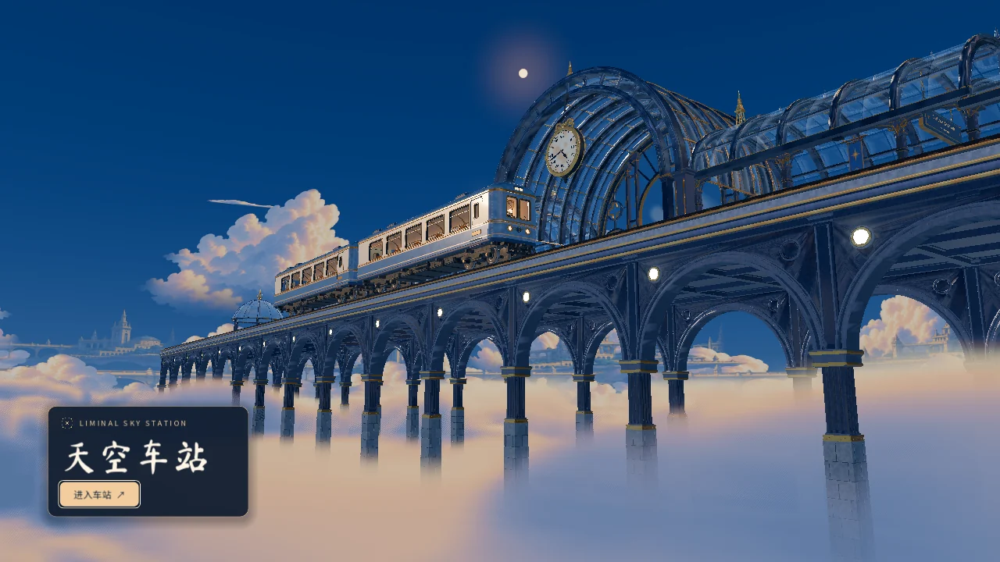

# LIMINAL 天空车站 · Godot

## [▶ 在线进入天空车站](https://joker0-hub.github.io/liminal-sky-station/)

在浏览器里漫游月台、飞进云海，看列车从西侧进站。开场显示加载进度，实时场景准备好后即可进入。引擎和场景文件未压缩时合计约 136 MB，实际下载量取决于服务器的传输压缩。

## 本地运行

用 Godot 4.7.2 的 Forward+ 运行 v048 天空车站。双击 `启动天空车站.cmd` 进入，默认以 1600 × 900 原生分辨率渲染。Godot 编辑器可直接打开 `project.godot`。

克隆源码时，需要 Git LFS 下载车站模型。

- 点击「进入车站」进入实时场景。1 和 2 分别切换月台、云海。
- 在月台按 Tab 或点击场景进入第一人称，WASD 步行，鼠标环视，Esc 释放光标。
- 云海支持左键拖动环视、右键平移、滚轮沿镜头方向进退、WASD 移动和 Q/E 升降。点击「复位镜头」或按 Home 回到云海起始机位。
- 点击「隐藏界面」或按 H 可收起控制栏。通过「显示界面」、H 或 Esc 恢复。
- E 开关站台侧车门。门打开后，翻盖和四级踏梯按 v048 的动画展开，约 2.4 秒后可登车。再次按 E 会先收梯，再关门。
- 进入车站后，列车从西侧驶入月台，减速停稳后自动开门放梯。按 T 可重播进站，列车会先收梯关门，再退回西侧。
- 大挂钟和报时塔读取系统当地时间，时针与分针每秒更新。

## 本地网页预览与构建

双击 `预览网页版.cmd` 打开本地浏览器预览。网页产物位于同级的 `liminal-godot-web/`，可以作为一整套静态文件部署。网页保留中文开场、月台探索、镜头控制和列车进站。

安装 Godot 4.7.2 的 Web 单线程导出模板和 Node.js 22 或以上版本后，用 `python tools/export_web.py` 重新构建。脚本在临时工程中优化高面数网格和浏览器用纹理，并使用 `Web` 导出预设。网页端采用 WebGL 2 兼容渲染、缩小的体积云网格和随包的中文字体。

网页画布上限为 2560 × 1440。3D 渲染按浏览器刷新率自适应，帧率目标最高为 90 FPS。掉帧时先调整几何细节和云层采样，再尝试降低 3D 分辨率。界面仍按画布分辨率绘制。可在网址后加 `?quality=2k` 锁定画布原生分辨率，或加 `?stats` 在开发者工具中用 `window.liminalRender` 查看帧率和缩放比例。

## 场景来源

`assets/v048/` 保留原场景可见的桥拱、棚架、轨道、列车内外、候车道具、站牌、远云和浮城。两节车厢连同车门转轴和车内灯一起移动。Godot 灯光沿用 v048 灯具的位置和朝向。月台青石使用 Blender 原材质的颜色、粗糙度和薄水膜，保留 Cycles 中月台的漫反射受光，并用独立的实时反射机位处理薄水反光。

`assets/volume/` 来自 `桥下云海_v042_侧光.vdb` 的 `density` 和 `sunlit` 网格。桥下与近景的体积云重新塑形，在桥墩间形成高低错落的云团和云谷。更远的云和浮城沿用 v048 中的画片、网格位置和 UV。

站房、桥体和列车外壳按 v048 成片校准。棚架玻璃沿用成片材质的掠射反射，车头、车侧和车顶使用源文件的板缝、铆钉与磨损贴图。体积光集中在高窗附近，窗格在月台石板上留下清晰的长影。道砟沿原轨床铺入不规则的立体碎石。

站台长椅与行李箱直接使用原始 4096 × 4096 和 8192 × 8192 底色贴图，并按 v048 的木面和皮革材质恢复凹凸与粗糙度。石板补回实尺矿物细纹，倒影随薄水分布增强。平面反射在镜头静止时以最高 900 像素高度渲染，走动和列车运行时使用较低分辨率。

站台和车厢壁灯用独立的玻璃罩、暖色灯泡和局部点光源。灯框和收边共用网格，远处的点光源逐渐淡出。地面离开画面时，月台的平面反射会暂停更新。

## 重新导入

由 Blender 5.2 后台打开 v048，分别用 `--python` 运行 `tools/bake_v048_floor.py`、`tools/render_v048_sky.py` 和 `tools/export_v048.py`。在 `--` 后传入相应的输出路径。`tools/export_v048_boarding.py` 导出 `assets/v048/boarding-v048.json`，保留原车门、翻盖、踏板和伸缩机构的动作。`tools/bake_v048_light.py` 接收 `--light` 或 `--surface` 加对应的 EXR 输出路径。最后用已安装 OpenVDB 和 NumPy 的 Python 运行 `tools/convert_v048_cloud.py`，依次传入原 VDB、导出的 `assets/v048/v048.json` 和体积输出目录。

生成灯罩使用的反射贴图时，用 `tools/render_v048_sky.py`，在 `--` 后传入 `assets/textures/sky-glass-v048.exr` 和 `--reflection`。

生成起伏后的桥下云海时，在体积转换之后用装有 NumPy 和 SciPy 的 Python 运行 `tools/shape_v048_clouds.py assets/volume`。
